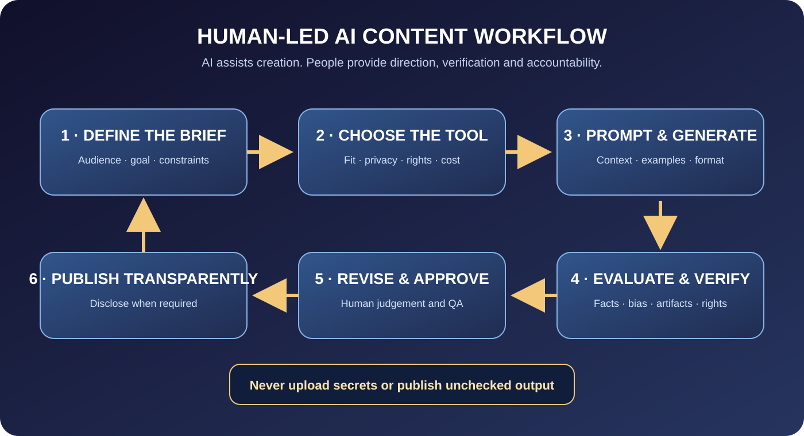

# AI Content Creation Practical — Stage 1: Foundations, Creative Direction and Responsible AI
**Duration:** 4 weeks | 6 hours/week | Beginner  
**Stage outcome:** Learners understand how generative AI works at a practical level, choose suitable tools for defined tasks, create a repeatable brief-to-output workflow, write and refine prompts, evaluate generated work and apply safety, rights, privacy and disclosure checks.

*Unique course artwork: a modern AI creative studio with a human creator directing a multimodal workflow. Do not reuse this image for YouTube Automation or other courses.*

## Visual learning map

## Delivery plan
- Week 1: Chapter 1 — Generative AI literacy and task selection.
- Week 2: Chapter 2 — Creative briefs and prompt engineering fundamentals.
- Week 3: Chapter 3 — Evaluation, iteration, human direction and responsible use.
- Week 4: Practical studio project and portfolio review.

## Chapter 1 — Generative AI literacy and task selection
### Learning outcomes
Learners can explain generative AI in plain language; distinguish model output from verified fact; recognise common failure modes; choose suitable tasks; and define when human review or specialist input is required.

### Teaching notes
**1. What generative AI does.** Generative systems produce new text, images, audio, video or structured outputs based on patterns learned during training and the context supplied at use time. They do not automatically know whether an answer is true, current, complete or appropriate. Different tools and models have different strengths, limits, data practices and usage terms.

**2. Common capability groups.** Text assistants help brainstorm, outline, explain and draft. Image models create or edit visuals. Audio tools may transcribe, clean, generate or transform speech. Video tools may generate clips, animate images or assist editing. Research tools may retrieve sources, but sources still need inspection. Automation tools connect steps and services, so permissions and failure handling matter.

**3. Failure modes.**
- Hallucination: plausible-sounding but false or invented details.
- Outdated information: model knowledge or retrieved material may not reflect the current state.
- Bias and representation problems: outputs may reproduce stereotypes or exclude perspectives.
- Prompt sensitivity: small wording changes may alter output.
- Inconsistency: repeated runs can produce different results.
- Copyright, privacy and consent risks: generated or uploaded content may involve protected or personal material.
- Overconfidence: fluent language can hide weak reasoning.

**4. Choose the right task.** AI is useful for drafts, variations, summarisation of supplied non-sensitive material, brainstorming, transcription and repetitive transformations. Human expertise remains essential for factual verification, taste, empathy, sensitive decisions, legal/medical/financial matters, final brand approval and accountability.

**5. Human-in-the-loop workflow.** The creator defines the goal, supplies context they have permission to use, asks for a draft, checks facts and quality, revises with judgement, approves the final asset and records relevant provenance. AI assistance does not transfer responsibility away from the publisher.

**6. Tool selection matrix.** Evaluate a tool by task fit, output quality, editing control, cost, usage rights, privacy/data retention, export formats, accessibility, reliability and learning curve. Do not select a tool solely because it is trending or offers a free trial.

### Educator demonstration
Take one brief—create a beginner-friendly explanation of a safe everyday digital task. Compare a text assistant, a search/research workflow and a human-written outline. Identify unsupported facts and show why the final explanation needs a reliable source check.

### Guided lab
Learners classify 12 example tasks as: AI suitable with review; human-led with AI assistance; or not appropriate to automate. They justify each decision using risk, data sensitivity and required expertise.

### Independent assignment — AI Task Selection Map
Submit five possible use cases in the learner's chosen creative niche. For each, define user/audience, desired output, tool category, human review, sensitive data risks, rights checks and success criteria. Select one low-risk project to develop in the next chapters.

**Rubric / 25:** AI literacy 5; task suitability 5; risk recognition 5; human review plan 5; measurable success criteria 5. Pass: 18/25.

### Knowledge check and answers
1. Does fluent AI text prove a claim is true? **No; important claims need independent verification.**
2. What is a hallucination? **A plausible output containing invented or unsupported information.**
3. Who is responsible for a published AI-assisted work? **The human or organisation publishing it remains responsible.**
4. Should confidential client data be pasted into any free AI tool? **No; first verify permission, privacy terms and organisational rules.**
5. What is a human-in-the-loop workflow? **A process where a person directs, checks and approves AI-assisted work.**
6. Is the newest tool always the best? **No; evaluate task fit, privacy, quality, cost and rights.**

### Common mistakes
Treating AI as an authority; uploading private files without checking terms; using the first generated output; choosing tools by hype; assuming AI removes copyright or disclosure responsibilities. Correct by verifying, minimising data, iterating and documenting decisions.

### Key vocabulary
Generative AI, model, prompt, hallucination, multimodal, human-in-the-loop, provenance, bias, data minimisation, evaluation.

### Resources
- NIST AI Risk Management Framework: https://www.nist.gov/itl/ai-risk-management-framework
- Google Generative AI learning resources: https://ai.google/education/
- OpenAI safety and policies: https://openai.com/policies/
- Creative Commons: https://creativecommons.org/share-your-work/

## Chapter 2 — Creative briefs and prompt engineering fundamentals
### Learning outcomes
Learners can turn a vague request into a useful brief; define audience, objective, format and constraints; structure prompts with context and examples; request appropriate output formats; and iterate without losing creative direction.

### Teaching notes
**1. Start with the brief, not the prompt.** A good brief states: audience, purpose, problem, key message, deliverable, platform/format, tone, factual requirements, exclusions, constraints, deadline and success criteria. A prompt cannot compensate for an unclear goal.

**2. Prompt anatomy.**
- Role or perspective: the useful expertise or viewpoint to apply; do not imply false credentials.
- Task: the action required.
- Context: audience, background and supplied facts.
- Inputs: source material or examples the user has permission to provide.
- Constraints: length, style, exclusions, safety and rights.
- Output format: table, outline, script, JSON or checklist.
- Quality criteria: what a successful answer must satisfy.
- Verification: ask for uncertainties, assumptions and source needs.

**3. A practical prompt pattern.**
“Help me create [deliverable] for [audience]. The audience needs [need]. Use this context: [approved context]. The output must [requirements]. Avoid [constraints]. Return it as [format]. Before finalising, identify assumptions, unsupported claims and missing information.”

**4. Give useful examples.** A short example can show the desired structure, voice or level of detail. Use original or authorised examples. Do not ask the model to copy a living creator's distinctive style; instead describe high-level traits such as concise, warm, technically clear or documentary-like.

**5. Break complex tasks into stages.** Ask for a brief, review it, generate an outline, approve structure, draft sections, verify claims and polish. This makes errors easier to detect than asking for a complete campaign in one prompt.

**6. Prompt iteration.** Change one important variable at a time. Tell the model what is wrong and what evidence or requirement it missed. Preserve strong parts. Ask it to list assumptions and questions instead of inventing missing details.

### Educator demonstration
Transform “Make me a viral ad” into a complete brief for a fictional local service. Build a prompt, inspect the draft, identify exaggerated claims, revise the message and output three formats: a short script, caption and shot list.

### Guided lab
Learners write three versions of a prompt for one task: vague, structured and iterative. Compare output relevance, factual discipline and editing effort.

### Independent assignment — Prompt Pack
Submit one creative brief, five reusable prompts for distinct workflow steps, an example input/output, a revision log showing at least two iterations and a verification checklist.

**Rubric / 25:** brief quality 5; prompt completeness 5; context and constraints 4; output format and criteria 4; iteration quality 4; safety/verification 3. Pass: 18/25.

### Knowledge check and answers
1. Why write a brief before a prompt? **It defines the actual audience, purpose and success criteria.**
2. Name five prompt components. **Task, context, inputs, constraints, output format, quality criteria (any five).**
3. Why request assumptions? **To expose missing information instead of silently inventing it.**
4. Should examples be copied from a creator without permission? **No; use authorised examples or describe general traits.**
5. Why iterate one variable at a time? **It helps identify which change improved or weakened the output.**

### Common mistakes
Vague commands; contradictory constraints; no audience; no output format; asking for facts without sources; treating the first answer as final. Correct with a brief, structured prompt, explicit criteria and staged review.

### Key vocabulary
Creative brief, context, constraint, output schema, few-shot example, iteration, assumption, evaluation criterion.

### Resources
- Google Prompting Essentials: https://grow.google/intl/ALL_us/prompting-essentials/
- OpenAI prompting guidance: https://platform.openai.com/docs/guides/prompt-engineering
- NIST AI RMF: https://www.nist.gov/itl/ai-risk-management-framework

## Chapter 3 — Evaluation, iteration, human direction and responsible use
### Learning outcomes
Learners can evaluate AI outputs against a rubric; verify factual claims; refine text and visuals; preserve originality and brand consistency; identify rights, privacy and disclosure issues; and maintain a reproducible production record.

### Teaching notes
**1. Evaluate against the brief.** Score relevance, accuracy, completeness, clarity, audience fit, originality, accessibility, brand fit and compliance. A beautiful output may still fail if it is inaccurate or misses the purpose.

**2. Fact-check text.** Extract material claims, locate authoritative sources, check dates and context, and correct or remove unsupported statements. For high-impact topics, use qualified review. AI-generated citations can be fabricated; open every cited source and verify that it supports the claim.

**3. Evaluate images and designs.** Inspect hands, text, logos, faces, product details, anatomy, consistency, cultural context and unintended artifacts. Confirm that generated text is spelled correctly; often it is better to add final typography in a design editor. Check that the image does not falsely depict a real event, person or endorsement.

**4. Iterate with a change log.** Record the prompt version, tool/model, date, input assets, settings where relevant, output, review notes and final decision. Store only information needed for reproducibility and never include secrets or unnecessary personal data.

**5. Human creative direction.** Make deliberate decisions about composition, message, pacing, tone and audience. Generate variations to explore options, then select and refine with a clear reason. Do not publish a generic output just because it looks polished.

**6. Rights, likeness and consent.** Check tool terms and asset licences. Do not imitate a real person's voice or likeness without permission. Avoid using protected logos, characters or artwork in ways that imply authorisation. Keep evidence of permissions and licences.

**7. Privacy and security.** Minimise input data, anonymise where possible, obtain permission and review retention/training settings. Never upload passwords, private records or confidential client material into an unapproved tool.

**8. Disclosure and transparency.** Platform and legal rules differ by content type and jurisdiction. Check current requirements for realistic synthetic or altered media, endorsements, advertising and other disclosures. Do not mislead viewers about evidence, testing or human involvement.

### Educator demonstration
Evaluate three fictional outputs: a text draft with invented statistics, an image with malformed text and an advertisement implying a false endorsement. Use a rubric to reject or repair them, verify claims and record the final approval.

### Guided lab
Learners evaluate their Stage 1 project output using a nine-point rubric, verify three factual claims, revise one visual or text element and create a provenance/change log.

### Independent assignment — Responsible AI Creative Portfolio
Submit the original brief, prompt versions, at least three output iterations, evaluation rubric, source verification record, final selected asset, rights/privacy checklist, disclosure decision and reflection describing what the human creator changed and why.

**Rubric / 25:** output quality and brief fit 5; fact-checking 5; iterative improvement 4; creative direction 4; rights/privacy/disclosure 5; provenance and reflection 2. Pass: 18/25. Unverified material claims, unauthorised likeness or privacy violations must be corrected before passing.

### Knowledge check and answers
1. Can an AI-generated citation be trusted without opening it? **No; verify source existence and relevance.**
2. Why evaluate against a rubric? **It makes quality checks consistent and tied to the brief.**
3. What should a creator do with an image that falsely implies a real endorsement? **Reject or correct it; do not publish the misleading implication.**
4. Why keep a prompt/change log? **To understand and reproduce the workflow while documenting decisions.**
5. Does AI generation remove the need for asset rights checks? **No.**
6. When should specialist review be used? **When the content is high-impact, regulated or beyond the creator's competence.**

### Common mistakes
Accepting invented citations; ignoring image artifacts; publishing deceptive synthetic media; failing to log licences; overloading prompts with private information. Correct with independent verification, careful visual inspection, transparency and data minimisation.

### Key vocabulary
Evaluation rubric, provenance log, synthetic media, likeness rights, disclosure, data minimisation, human approval, quality assurance.

### Resources
- NIST AI Risk Management Framework: https://www.nist.gov/itl/ai-risk-management-framework
- YouTube altered/synthetic content guidance: https://support.google.com/youtube/answer/14328491
- Creative Commons licences: https://creativecommons.org/share-your-work/cclicenses/
- OpenAI policies: https://openai.com/policies/

## Stage 1 capstone — AI-Assisted Creative Asset
Create one useful asset for a clearly defined audience: for example, a short educational script plus matching visual, a social campaign concept or an explainer infographic. Submit brief, prompt versions, outputs, verification, rights/privacy decisions, final deliverable and reflection.

**100-point rubric:** brief and audience 15; prompt quality 15; output usefulness 15; accuracy and verification 15; creative direction and iteration 15; visual/accessibility quality 10; rights/privacy/disclosure 10; provenance/reflection 5. Pass: 70/100 and all critical safety checks passed.

## Admin publishing checklist
Admins must be able to edit the stage/chapter association, course-specific hero image, diagrams, alt text, outcomes, lesson notes, demonstrations, prompt templates, examples, assignments, quiz questions and answers, rubric, references and review dates. Admins control ordering, draft/review/approved/published state, preview, revision history, restore and archive. No material becomes student-visible until explicitly published.
