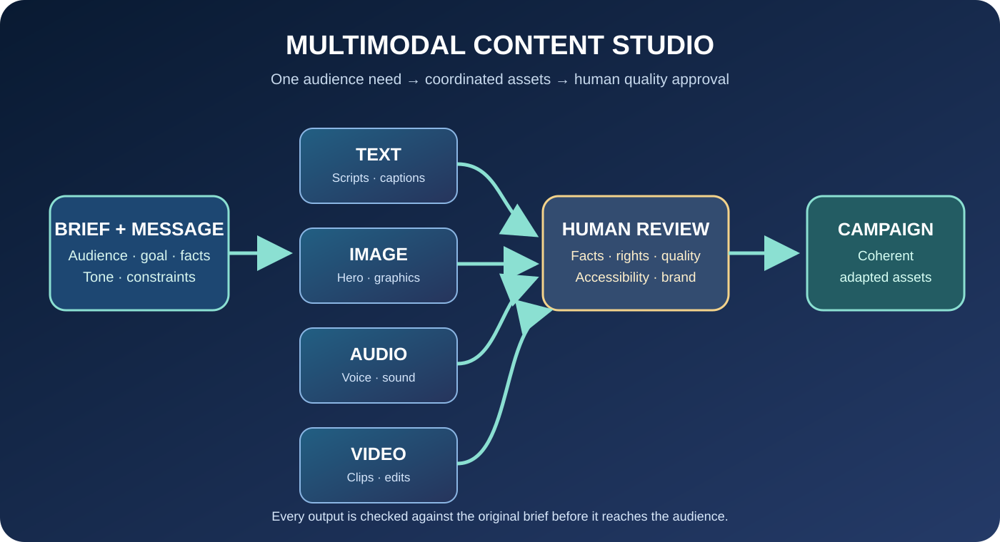

# AI Content Creation Practical — Stage 2: Multimodal Content Studio
**Duration:** 4 weeks | 6 hours/week | Beginner–Intermediate

*Unique artwork for this course: creator workstation with storyboard, design canvas, microphone and editing timeline. Do not reuse the YouTube Analytics or AI Foundations artwork.*

## Visual learning map

**Stage outcome:** Create coherent text, image, audio and short-video assets from one audience-led brief; deliver editable, quality-checked files with rights and provenance records.

## Chapter 1 — AI-assisted writing and content systems
**Learning outcomes:** Create audience-led briefs; draft multiple formats; maintain consistent messages; edit for voice and accuracy; repurpose ideas without producing repetitive filler.

### Teaching content
1. **Start with an audience need.** Define the specific viewer, their problem and the useful outcome. Gather approved facts, product information and references before drafting. Never invent testimonials, product capabilities or results.
2. **Build a message hierarchy.** Write one central message, up to three supporting points, evidence/examples, limitations and one relevant next step. This hierarchy keeps scripts, captions, emails and carousels consistent.
3. **Draft for the destination.** A short video needs spoken language and visual cues; a carousel needs a logical slide sequence; an email needs useful context and one action; an article needs evidence and depth. Do not paste one paragraph into every platform.
4. **Use AI for alternatives.** Generate hooks, outlines, examples or structures. Select and edit. Remove generic phrases, exaggerated claims and language that does not fit the brand.
5. **Repurpose by transforming.** Adapt structure and emphasis to the platform and audience. A transcript is not automatically a good caption. Preserve facts while changing the format.
6. **Editorial review.** Verify names, dates, numbers, links, claims, tone, reading level, accessibility and CTA. Read scripts aloud and check that each promise is fulfilled.

### Educator demonstration
Use a fictional small-business launch brief. Build a message map, then create a short-video script, carousel outline, email and caption. Show how the structure changes while the facts remain consistent.

### Guided practice
Turn one approved brief into three formats. Peer-review the central message, unsupported claims, filler and platform fit.

### Assignment — One Brief, Four Formats
Submit audience brief and message map; 45–60 second script; six-slide carousel outline; short email; platform caption; source notes; revision log.

**Rubric / 25:** audience and brief 4; message hierarchy 4; format adaptation 5; accuracy 5; voice and clarity 4; revision record 3. Pass 18.

### Knowledge check with answers
1. Why use a message hierarchy? **To keep the main message and evidence consistent.**
2. Is repurposing copying the same paragraph? **No; adapt structure and emphasis.**
3. What happens to unsupported product claims? **Verify, qualify or remove.**
4. Why read scripts aloud? **To check natural speech and pacing.**
5. Useful AI variation task? **Generate alternative hooks or structures for human selection.**

**Common mistakes:** generating volume without an audience; identical copy everywhere; generic tone; invented benefits; no fact check.  
**Vocabulary:** message hierarchy, repurposing, editorial voice, content pillar, hook, CTA, revision log.  
**Resources:** https://grow.google/intl/ALL_us/prompting-essentials/ · https://creatoracademy.youtube.com/ · https://www.plainlanguage.gov/guidelines/

## Chapter 2 — Image generation, design direction and brand consistency
**Learning outcomes:** Write visual briefs; describe subject, composition, lighting, palette and format; generate and compare concepts; refine outputs; add precise typography; check accessibility and rights.

### Teaching content
1. **Visual brief first.** Define purpose, audience, placement, subject, focal point, composition, aspect ratio, mood, palette, lighting, background, text requirements and exclusions.
2. **Image prompt structure.** Describe subject/action; setting; composition/viewpoint; lighting; palette; mood; high-level visual treatment; aspect ratio; required details and exclusions. Avoid imitating a living artist's exact style or implying a real person's endorsement.
3. **Composition and hierarchy.** Use one primary focal point, supporting details and negative space. Design for the final placement: vertical cover, square post, wide banner or thumbnail. Test crop and small-size readability.
4. **Typography.** Image models may render text incorrectly. Generate a visual/background, then add important wording in a design editor. Check spelling, contrast, line length, size and safe margins.
5. **Brand consistency.** Define approved logo, colour tokens, typography, image treatment, spacing, icon style and tone. Consistency means belonging to the same system, not making every image identical.
6. **Iterative art direction.** Generate a few purposeful variations. Compare clarity, relevance and brand fit. Make one clear correction per iteration: move subject left, reduce clutter, soften light or remove an irrelevant object.
7. **Accessibility and rights.** Write meaningful alt text for informative images. Check tool terms, licences, input-image permission and likeness consent. Do not present generated scenes as evidence of real events.

### Educator demonstration
Create a visual brief for a digital skills course cover. Compare three compositions, refine one for mobile crop, add exact typography in a design editor and write alt text.

### Guided practice
Create one hero image and one supporting visual. Submit brief, prompts, iterations and a mobile crop test.

### Assignment — Mini Visual Identity Pack
Submit hero visual, two supporting assets, brief, prompt history, palette/type notes, mobile crop test, alt text and rights/provenance log.

**Rubric / 25:** brief 4; composition 5; prompt/iteration 4; brand consistency 4; legibility/accessibility 4; rights/provenance 4. Pass 18.

### Knowledge check with answers
1. Why a visual brief first? **It defines the communication goal and composition.**
2. Why add text in a design editor? **Generated text can be inaccurate and hard to control.**
3. What is negative space? **Intentional low-detail area supporting clarity.**
4. Why test mobile crop? **The final placement may crop and shrink the design.**
5. What is alt text? **A concise description conveying an image's purpose or information.**

**Common mistakes:** overloaded prompts; too many focal points; unreadable generated text; inconsistent brand colours; no crop test; missing alt text.  
**Vocabulary:** visual brief, composition, focal point, negative space, aspect ratio, art direction, identity, alt text.  
**Resources:** https://www.w3.org/WAI/tutorials/images/ · https://color.adobe.com/ · https://creativecommons.org/share-your-work/cclicenses/

## Chapter 3 — Audio, video and campaign assembly
**Learning outcomes:** Storyboard short-form content; record narration responsibly; use AI transcription/editing assistance; assemble coherent video; add captions and sound; export a consistent campaign.

### Teaching content
1. **Storyboard.** Break script into visual beats. Each beat includes narration, visual action, on-screen text, asset/source reference and approximate duration.
2. **Audio.** Record a test in a quiet space with consistent microphone distance. AI enhancement may introduce artifacts; listen to the final audio. Never clone a real person's voice without permission.
3. **Video tools.** Choose by task fit, clip length, aspect ratio, editability, rights, cost and quality. Generated footage can contain inconsistent objects, text or motion; inspect it and never use it as proof of a real event.
4. **Editing order.** Assemble narration/main action first, then visuals, captions, sound and finishing. Prioritise story clarity over transitions. Keep original files and organised project folders.
5. **Captions and sound.** Correct automatic transcription, especially names, numbers and specialist terms. Keep music below speech. Do not communicate essential meaning only through colour or sound.
6. **Campaign assembly.** Produce the main video plus cover/thumbnail, caption, supporting graphic, description and rights log. Keep facts and brand treatment consistent while adapting each format.
7. **Final QA.** Check resolution, aspect ratio, audio sync, captions, spelling, logo use, safe margins, rights, privacy and playback on a phone.

### Educator demonstration
Build a 30-second explainer from a storyboard. Record narration, add original/licensed visuals, assemble the timeline, correct captions, add quiet music and export vertical and square variants.

### Guided practice
Create a 15–30 second clip. A peer reviews narration, visual relevance, captions, rights and mobile readability.

### Assignment — Multimodal Campaign
Submit 30–60 second video, hero image, supporting graphic, caption/description, storyboard, editable project where available, asset log, corrected captions and export checklist.

**Rubric / 25:** storyboard/message 4; narration/audio 4; visual continuity 4; editing/pacing 4; captions/accessibility 3; campaign consistency 3; rights/privacy/QA 3. Pass 18.

### Knowledge check with answers
1. Why storyboard first? **To ensure each visual supports the message.**
2. Can noise reduction damage audio? **Yes; listen for artifacts.**
3. Why correct captions? **Names, numbers and technical terms are often misrecognised.**
4. What is a campaign package? **Coordinated assets adapted to different placements.**
5. What must final QA include? **Playback, sound, captions, aspect ratio, rights, privacy and legibility.**

**Common mistakes:** random clips without a storyboard; synthetic voices without consent checks; loud music; uncorrected captions; no phone review.  
**Vocabulary:** storyboard, visual beat, voiceover, transcription, caption, sound design, campaign package, export QA.  
**Resources:** https://support.google.com/youtube/answer/1722171 · https://support.google.com/youtube/answer/2734796 · https://obsproject.com/kb/ · https://www.w3.org/WAI/tutorials/

## Stage 2 capstone — Integrated Multimodal Campaign
Create one campaign for a defined audience need. Submit brief, message map, prompt history, short video, hero image, supporting graphic, caption, description, corrected captions, asset log, verification/rights checklist and reflection.

**100-point rubric:** brief/message 10; text adaptation 15; visual concept/brand system 15; audio/video 20; accessibility/mobile QA 10; accuracy 10; rights/privacy/disclosure 10; portfolio/reflection 10. Pass 70 and all critical rights/privacy checks.

## Educator marking protocol
Score against the rubric; cite exact asset/section; identify two strengths and up to three priority revisions; give a model correction and one next action. Evaluate learner decisions, not expensive equipment.

## Admin publishing checklist
Admins can edit stage/chapter text, unique hero, diagrams, alt text, prompt examples, demonstrations, assignments, rubrics, answers, references and review dates. Admins control ordering, draft/review/approved/published state, preview, revision history, restore and archive. Publishing requires a separate explicit action.
