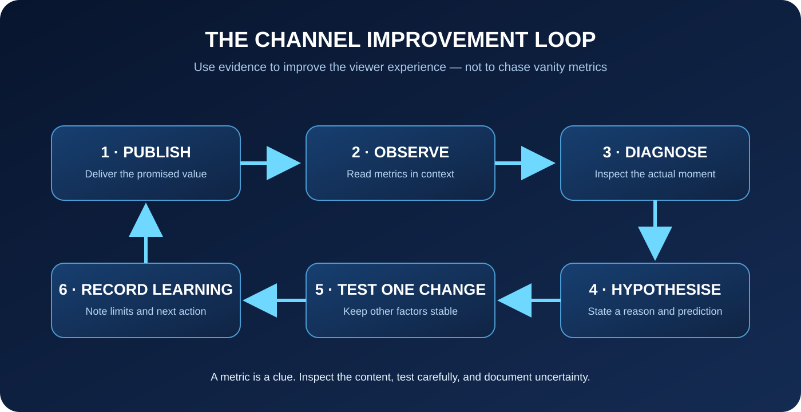

# YouTube Automation — Stage 4: Analytics, Channel Management, Sustainable Growth and Monetisation
**Duration:** 4 weeks | 6 hours/week | Beginner–Intermediate  
**Stage outcome:** Learners can read channel analytics without chasing vanity metrics, diagnose audience experience, plan a sustainable publishing system, build ethical growth loops and understand monetisation routes, eligibility and responsibilities.

*Course artwork direction: a modern analytics workstation with audience charts, content calendar and creator dashboard. This image is specific to analytics and must not be reused as another course's hero.*

## Visual learning map

The cycle is: publish → observe audience behaviour → diagnose a specific friction point → form a testable hypothesis → improve one variable → compare results → document the learning. Analytics informs decisions; it does not guarantee outcomes.

## Delivery plan
- Week 1: Chapter 1 — Analytics literacy and audience experience.
- Week 2: Chapter 2 — Channel operations, content systems and sustainable growth.
- Week 3: Chapter 3 — Monetisation, business models and creator responsibility.
- Week 4: Capstone — 30-day channel operating plan and analytics review.

## Chapter 1 — Analytics literacy and audience experience
### Learning outcomes
Learners can distinguish reach, clicks, views, watch time, retention, returning viewers and subscriber measures; read traffic-source reports; diagnose a video using context; and write a testable improvement hypothesis.

### Teaching notes
**1. Metrics are signals, not grades.** Views show consumption under the platform's measurement definitions; impressions and click-through rate describe part of the packaging journey; watch time and average view duration describe viewing; audience-retention graphs show where viewers continue or leave; returning viewers and subscriber changes give clues about audience relationships. Each metric has a definition and limitations. Read the current YouTube Analytics help documentation before interpreting a changed report.

**2. Read the whole journey.** A viewer may encounter an impression, decide whether the title/thumbnail is relevant, start watching, decide whether the opening fulfils the promise, continue through the explanation, then choose whether to return. A low result at one step does not identify the cause by itself. Compare like with like: similar topics, formats, video lengths, traffic sources and time windows.

**3. Interpret patterns carefully.**
- Many impressions but weak click-through: investigate topic-audience fit and packaging; do not assume thumbnail alone is the cause.
- Strong clicks but early exits: inspect expectation mismatch, opening clarity, audio, pacing and whether the answer arrives.
- Good retention but limited reach: the video may serve a narrow audience; review topic scope and discovery sources rather than rewriting blindly.
- Search traffic: check query relevance and whether the video answers the searcher's intent.
- Returning viewers: inspect which topics and formats create repeat value; avoid assuming a single upload caused loyalty.

**4. Retention graph reading.** Look for the opening drop, stable sections, spikes and dips. A spike may indicate a useful replay, confusing moment or external timestamp link; a dip may indicate repetition, interruption or an answer that was not relevant. Inspect the actual segment before drawing a conclusion.

**5. Hypothesis-based improvement.** Write: “For [audience], changing [one element] from [current state] to [new state] may improve [specific experience/metric] because [evidence]. I will compare [similar videos or test period] while keeping [other variables] as stable as possible.” Avoid changing title, thumbnail, opening and length simultaneously if you want to learn what mattered.

**6. Small samples and uncertainty.** New or small channels have noisy data. Do not overinterpret a handful of views or a short time window. Record the sample size, time window, traffic mix and important differences. Make reversible, low-risk improvements and accumulate evidence.

### Educator demonstration
Use a fictional channel report, not a student's private analytics. Compare two videos with different lengths and traffic sources. Identify a retention dip, watch the segment, form one plausible hypothesis and propose a fair comparison. Explain why the data cannot prove causation.

### Guided lab
Learners receive a mock dashboard with impressions, CTR, views, average view duration, retention and traffic sources. They write three observations, two competing explanations and one next test. They must identify at least one conclusion the data does not justify.

### Independent assignment — Analytics Diagnosis
Submit a one-page report using a provided mock dataset or the learner's own voluntarily shared, redacted data: define the period and sample; explain five metrics; diagnose one video; write one testable hypothesis; propose a next action; and list limitations.

**Rubric / 25:** metric definitions 5; context and comparisons 5; diagnosis grounded in evidence 6; testable hypothesis 5; uncertainty and privacy 4. Pass: 18/25.

### Knowledge check and answers
1. Does CTR alone prove a thumbnail is bad? **No; topic, audience, traffic source and impression context matter.**
2. What is audience retention useful for? **Finding where viewers continue, replay or leave, then inspecting those moments.**
3. Does a spike always mean success? **No; it may be a replay, confusion or a linked moment.**
4. Why compare similar videos? **To reduce misleading differences in format, length, audience and traffic mix.**
5. Can analytics prove a change caused growth? **Usually not from a simple before/after comparison; other factors may differ.**
6. What should a learner do with a tiny sample? **Record uncertainty and avoid strong conclusions.**

### Common mistakes
Treating views as the only measure; comparing unlike videos; declaring causation; changing too many variables; exposing private analytics screenshots. Correct with context, careful hypotheses, redaction and documented limitations.

### Key vocabulary
Impression, click-through rate, average view duration, watch time, audience retention, traffic source, returning viewer, cohort, hypothesis, sample size.

### Resources
- YouTube Analytics overview: https://support.google.com/youtube/answer/9002587
- Understand video performance: https://support.google.com/youtube/answer/9314355
- Audience retention: https://support.google.com/youtube/answer/9314415

## Chapter 2 — Channel operations, content systems and sustainable growth
### Learning outcomes
Learners can create a realistic content calendar; manage repeatable production tasks; maintain a channel identity; plan series and community interaction; use collaboration responsibly; and protect account security and creator wellbeing.

### Teaching notes
**1. Build a repeatable operating system.** Use a simple pipeline: idea → evidence check → brief → script → production → quality review → scheduled/published → analytics review → learning log. Every item has an owner, next action, due date and status. A calendar is a planning aid, not a promise to upload at an unsustainable pace.

**2. Choose a sustainable cadence.** Estimate real hours for research, scripting, production, editing and review. Start with a cadence the creator can maintain while preserving accuracy and quality. Batch compatible tasks only when it reduces effort. Keep buffer time for corrections, illness, school/work and unexpected changes.

**3. Channel identity and content pillars.** Define the intended audience, channel promise, tone, visual identity and three to five repeatable topic pillars. Consistency means a recognisable viewer benefit, not identical thumbnails or repetitive content. Review the identity when audience needs or expertise change.

**4. Series and content libraries.** Group related videos into playlists and series where it helps navigation. Each video should still deliver a complete answer. Use end screens, cards and descriptions only when the destination is genuinely relevant and available. Refresh old videos when facts or interfaces change; clearly note material updates.

**5. Community management.** Reply constructively, set boundaries and moderate harassment, spam and harmful content. Never publish private viewer information. Do not promise personal support the creator cannot provide. Establish a moderation escalation path for credible threats or safety concerns and use platform reporting tools.

**6. Collaboration.** Agree on roles, deliverables, rights, attribution, revenue split, access and approval before production. Use least-privilege account access; never share passwords. Document permission for likeness, voice, music and footage.

**7. Account security and continuity.** Use unique passwords and available multi-factor authentication, protect recovery methods, review channel permissions and connected applications, and keep secure backups. Never give an unknown “manager” owner access. Separate business records from public content.

**8. Wellbeing and integrity.** Do not use bots, purchased engagement, spam comments or deceptive giveaways. Set boundaries for comments and work hours. A sustainable channel is built around viewer value, not constant activity.

### Educator demonstration
Build a four-week calendar from a realistic time budget. Show one content item moving through pipeline stages, a revision triggered by an official product update, and a moderation scenario requiring privacy and safety boundaries.

### Guided lab
Learners create three content pillars, map eight ideas into a four-week calendar, estimate production hours and write a simple channel access/security checklist.

### Independent assignment — Channel Operations Pack
Submit channel promise, audience profile, content pillars, four-week calendar, production workflow, revision policy, moderation principles, collaboration checklist and security checklist.

**Rubric / 25:** audience and channel positioning 4; content pillars 4; realistic cadence and time budget 5; operational workflow 4; moderation/privacy 4; security and collaboration 4. Pass: 18/25.

### Knowledge check and answers
1. What is a sustainable cadence? **A publishing rhythm that can be maintained without sacrificing quality or wellbeing.**
2. Why use a content pipeline? **It makes ownership, status and next actions visible.**
3. Should a collaborator receive the channel password? **No; use supported role-based permissions and least privilege.**
4. What should happen when an old video becomes inaccurate? **Review, correct or update it transparently.**
5. Is community management the same as answering every comment? **No; creators need boundaries and moderation rules.**

### Common mistakes
Overcommitting; publishing without review; giving broad account access; ignoring old inaccurate videos; reacting impulsively to abusive comments. Correct with realistic calendars, role permissions, review queues and moderation procedures.

### Key vocabulary
Content pillar, content calendar, production pipeline, playlist, community moderation, least privilege, multi-factor authentication, revision policy.

### Resources
- YouTube channel permissions: https://support.google.com/youtube/answer/9481328
- YouTube community moderation: https://support.google.com/youtube/answer/9483359
- Google Account security: https://myaccount.google.com/security

## Chapter 3 — Monetisation, business models and creator responsibility
### Learning outcomes
Learners can distinguish platform monetisation from broader creator business models; check current eligibility requirements; estimate costs and revenue conservatively; identify sponsorship and affiliate obligations; and protect viewers from deceptive or unsuitable promotions.

### Teaching notes
**1. Monetisation is not guaranteed.** Platform programmes have eligibility thresholds, country availability, policy requirements and changing features. Never promise that a channel will earn a specific amount or qualify by a particular date. Always check the current official programme page for the learner's country and account.

**2. Possible revenue models.**
- Platform advertising and eligible premium revenue sharing.
- Memberships, fan funding and live features where available.
- Sponsorships and brand partnerships.
- Affiliate commissions with clear disclosure.
- Products, services, templates or courses that genuinely help the audience.
- Licensing or commissioned work where rights permit.

Each model has costs, eligibility, taxes, audience trust and operational demands. Not every model suits every niche or creator.

**3. Revenue and cost literacy.** Distinguish gross revenue, platform fees, refunds, taxes, production costs and net profit. Keep records. Use conservative scenarios, not viral outliers. A simple planning model is: estimated net = collected revenue − platform/payment fees − refunds − production/operating costs − tax obligations. This is educational arithmetic, not tax or financial advice.

**4. Sponsorship and affiliate transparency.** Disclose material relationships clearly and close to the recommendation, using platform disclosure tools where required. Do not make claims that the creator cannot substantiate. Keep contracts, deliverables, payment terms, usage rights, exclusivity and approval terms in writing. Decline campaigns that conflict with audience safety or the creator's values.

**5. Viewer-first product choices.** Recommend only products/services that fit the audience and can be described honestly. Explain limitations and conflicts. Never disguise an advertisement as an independent review. Do not fabricate testimonials, results or scarcity.

**6. Policy, legal and tax checks.** Requirements vary by country, product category and platform. Check current local advertising, consumer protection, privacy, tax and platform rules. Seek qualified advice for contracts, taxes or regulated products. Do not offer professional legal, medical or investment advice without the appropriate qualification.

**7. Diversification and resilience.** Avoid depending entirely on one platform or one sponsor. Build a permission-based audience relationship, maintain backups and keep business records. Diversification reduces concentration risk but does not guarantee income.

### Educator demonstration
Use a fictional creator with modest views and show how to compare a small sponsorship, affiliate offer and digital product. Include time, fees, refunds and costs. Identify an undisclosed affiliate link and rewrite the recommendation transparently.

### Guided lab
Learners assess three fictional monetisation offers, flag conflicts and risks, calculate simple net scenarios, and draft a disclosure statement appropriate to one offer.

### Independent assignment — Ethical Monetisation Plan
Submit two suitable revenue models, current eligibility research with official links and date checked, simple conservative cost/revenue scenarios, a disclosure example, sponsor-screening checklist and a list of professional advice areas.

**Rubric / 25:** model suitability 5; current eligibility research 5; realistic arithmetic 4; disclosure and honesty 5; viewer safety and risk 4; recordkeeping 2. Pass: 18/25.

### Knowledge check and answers
1. Is monetisation eligibility permanent? **No; requirements and account status can change.**
2. What is net revenue? **Revenue remaining after relevant fees, refunds, costs and obligations are accounted for.**
3. Must affiliate relationships be disclosed? **Yes, clearly and in accordance with applicable rules and platform requirements.**
4. Should a creator guarantee product outcomes? **No; claims must be truthful and supported.**
5. Is a viral revenue screenshot a reliable forecast? **No; it lacks context and may not represent typical results.**
6. Why diversify? **To reduce dependence on one platform or income source, not to guarantee earnings.**

### Common mistakes
Promising quick money; confusing revenue with profit; hiding affiliate links; accepting unsuitable sponsors; relying on outdated eligibility claims. Correct through current official checks, conservative modelling, clear disclosure and audience-first screening.

### Key vocabulary
Eligibility, gross revenue, net revenue, sponsorship, affiliate disclosure, revenue diversification, deliverable, exclusivity, refund, recordkeeping.

### Resources
- YouTube Partner Programme overview: https://support.google.com/youtube/answer/72851
- YouTube monetisation policies: https://support.google.com/youtube/answer/1311392
- Paid product placements and endorsements: https://support.google.com/youtube/answer/154235
- Google AdSense policies: https://support.google.com/adsense/answer/48182

## Stage 4 capstone — 30-Day Channel Operating and Improvement Plan
Submit: channel promise and pillars; four-week calendar; one complete production pipeline; a redacted analytics diagnosis; two evidence-based improvement hypotheses; community/moderation and account-security plan; monetisation suitability matrix; current eligibility source log; and a 30-day review schedule.

**100-point rubric:** analytics literacy 20; quality of diagnosis and testing 15; realistic operations 15; audience/community stewardship 10; security and privacy 10; monetisation research 15; ethics/disclosure 10; clarity and reflection 5. Pass: 70/100. Critical privacy, deceptive monetisation or policy failures require correction before completion.

## YouTube Automation — Full course completion standard
A learner completes all four stages and submits:
1. Channel strategy and audience brief.
2. Research and topic-selection portfolio.
3. Production-ready script and evidence ledger.
4. Finished pilot video and publish-ready package.
5. Analytics diagnosis and channel operations plan.
6. Ethical monetisation plan and 30-day improvement cycle.

**Final pass:** 70% overall, all four stage capstones submitted, and all critical source, rights, privacy, policy and disclosure checks passed.

## Educator marking protocol
Return rubric scores, evidence-based feedback, two strengths, up to three priority revisions, exact section references, a model correction and one next action. Keep feedback educational, not merely a rewritten answer.

## Admin publishing checklist
Admin can edit title, stage association, summaries, outcomes, lesson content, diagrams, unique hero artwork, image alt text, demonstrations, practice tasks, assignments, answer keys, rubrics, resources and review dates. Admin controls ordering, draft/review/approved/published state, preview, revision history, restore and archive. Approval never automatically publishes. External eligibility and policy links must be reviewed before publication.
